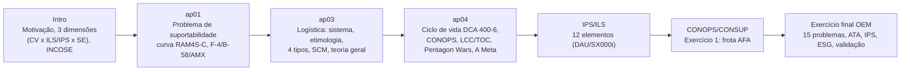

# MB-249 - Guia de Estudo

**Disciplina:** MB-249 Logística no Desenvolvimento de Sistemas Aeroespaciais Complexos (Mestrado Profissional ITA-EMBRAER, Turma 2).
**Professor:** Prof. Donizeti de Andrade, Ph.D. (nome no rodapé dos slides). Os decks ap03/ap04 trazem "Instrutor: Fernando Teixeira Mendes Abrahão" e as notas de aula são de ABRAHÃO, F.T.M.A. (AeroLogLab-ITA). Confirmar autoria/banca.
**Prova (Introdução, S6):** "Abrangem ...só tudo!!!"; sem consulta; 50% objetiva + 50% dissertativa; 90 min; 8ª semana.

Convenções: `Intro` = MB_249_2026_Introdução; `ap01` = O Problema de Suportabilidade; `ap03` = Logísticas; `ap04` = Ciclo de vida de sistemas; `AFA` = CONOPS & CONSUP Frota de Treinamento da AFA; `ExF` = CONOPS Exercício final. "S12" = slide 12. Texto entre aspas = literal. **[NC]** = não consta no material. **[comp.]** = complemento de fonte externa/vault, fora dos slides.

Relacionadas no vault: [[Ciclo de Vida de Engenharia de Sistemas]] · [[V-Model (Vee Model)]] · [[MBSE e o Pensamento de Ciclo de Vida Completo (Left-Shift)]] · [[NASA Systems Engineering Handbook]] · [[Fase E - Operações e Sustentação]] · [[Fase F - Encerramento (Closeout)]] · [[Fases de Implementação e Encerramento (C-F)]] · [[Cheat Sheet - SE Life Cycle]]

---

## 1. Mapa da disciplina

Conteúdo programático (Intro, S3): (1) Problema de Suporte/Suportabilidade; (2) Sistemas: conceitos e definições; (3) Ciclo de vida de sistemas complexos: fases, características logísticas e custos; (4) Logística no desenvolvimento de sistemas; (5) Suporte Integrado do Produto (IPS); (6) Ferramenta de modelagem e simulação.

Fio condutor: **o problema de suporte é de dinheiro** ("O problema de suporte $$ ??????", ap01 S5; ap03 S4/S34) → a maior parte do custo é O&S e é **travada nas decisões iniciais** (ap04 S72; DCA 400-6/2025 p.6) → logo a suportabilidade tem de entrar **no conceito/design** (CONSUP nasce na Concepção, ap01 S9) → a ferramenta organizadora é o **IPS** (12 elementos) aplicado **em cada fase** do ciclo de vida (o "Map", Intro S24) → o instrumento que traduz isso para o usuário é o **CONOPS** focado em suportabilidade, e o caso prático é a **frota de treinamento da AFA** e o **exercício final** (perspectiva do OEM).

Mensagem pedagógica (Intro S30, CDIO): em vez de só transformar mantenedores em desenvolvedores, "treinar e educar os DESENVOLVEDORES para serem (pensar, entender, agir, desenvolver) melhores mantenedores".

---

## 2. Os 15 temas centrais

### T1. O problema de suporte/suportabilidade

- **Motivação (Intro S14):** (i) entendimento limitado do que é Engenharia Logística na comunidade aeronáutica e de aquisição; (ii) aquisição recente de sistemas de armas com suporte complexo; (iii) educação em engenharia logística limitada, "especialmente em cursos de graduação", focada em formar mantenedores, não desenvolvedores/engenheiros de conceito ⇒ "Problema de suporte/suportabilidade!!!".
- **3 dimensões do escopo de suportabilidade (Intro S22):** (1) perspectiva do ciclo de vida; (2) abordagem ILS ("ILS Elements", considerados de forma temporal e integrada); (3) abordagem de Engenharia de Sistemas (requisitos de suporte definidos, analisados, projetados, implementados, integrados, testados, validados).
- **O "Map" (Intro S24):** linhas = fases do ciclo de vida; colunas = elementos ILS/IPS (Blanchard, DoD, FAB, ASD, NATO). Cada interseção = tópicos a tratar naquela fase para aquele elemento + impactos nas fases seguintes. A SE fica "sobre o mapa", guiando os esforços de engenharia de suportabilidade.
- **Requisitos de alto nível de suporte (ap01 S10):** precisão e exatidão do sistema de manutenção (diagnóstico correto); consciência situacional (aeronave + sistema de suporte avisam degradação); capacidade de diagnosticar e atuar.
- **Derivar requisitos por modelagem (ap01 S28-S31):** "Dado um CONOPS, ou uma avaliação de mercado, demandando mais desempenho Logístico... como derivar todos os novos requisitos de suportabilidade, baseado em modelagem matemática e simulação???". 3 modelos: (1) **do sistema (frota)**: R, M, A, Suportabilidade, Sustentabilidade, segurança, custos; (2) **do sistema de suporte à frota**: oficinas, transporte, manuseio, estocagem, gerenciamento, localização, custos; (3) **da operação esperada**: horas, missões, esquadrões, localização. Exemplo numérico do slide: disponibilidade 100% vs 71%; custos 7 M vs 11 M (atual vs novo) - unidade monetária [NC].

### T2. Curva de maturidade RAM4S-C ao longo do ciclo

- **Figura 02 (ap01 S7-S8):** eixo x = Conceito, P&D, Produção, (Implantação), Operação e Suporte, Descarte; eixo y = "Relação Custo Benefício esperada do produto" (Bom / Não Bom). "Curva desejável de maturidade de RAM4S-C": o sistema deve chegar maduro ao 1º usuário.
- **Intro S26-27:** curva desejada vs "Late RAMS maturity (Reality)".
- **3 pontos (ap01 S24-S27):** 1 = curva desejável; 2 = parada do desenvolvimento do suporte (maturidade nunca atingida); 3 = maturidade tardia (curva "escorrega para a direita").
- **O&S em dentes de serra (ap01 S17-S18):** "linha pontilhada em dentes de serra desiguais" = desempenho real de suportabilidade com idade/uso; o suporte identifica e corrige deteriorações; eventualmente **Mid Life Upgrade (MLU)**. Se os serviços não são entregues de forma controlada e a tempo, as degradações acumulam.
- **Gráfico A x $$ (ap01 S21):** curva de referência vs curva esperada do novo projeto vs metas (goals) - objetivo: mais disponibilidade com menos custo.
- **RAM4S-C:** Reliability, Availability, Maintainability, Supportability, Sustainability, Safety (segurança de dados e de voo) + Cost (custos); ap01 S9 cita também Testabilidade. A expansão exata da sigla não é dada literalmente em um único slide (ver Pegadinhas).

**Casos (ap01 S23-S27; Russell 2007):**

| Caso | O que ilustra | Dados do material |
|---|---|---|
| **F-4 Phantom II** (McDonnell Douglas) | Cenário 1: maturidade **atrasada** | Entrou em serviço "no início dos sessentas", declarado maduro em **1974**; "cerca de 20 anos" imaturo; "declarada madura a apenas 5 anos do início de sua aposentadoria (1981) com a chegada dos GD F-16s" (ap01, nota S24) |
| **B-58 Hustler** (Convair) | Cenário 2: maturidade **nunca atingida** (ponto 2) | Baixa confiabilidade/manutenibilidade → baixa disponibilidade, HH/FH enorme, suporte desproporcional; projeto cancelado e frota retirada (Abrahão et al. 2019 apud Russel 2007). Russell 2007: 1º bombardeiro supersônico dos EUA; "In 1965 early retirement was ordered"; motivou gestão de configuração, engenharia R&M e LCC |
| **AMX** | Risco de maturidade nunca atingida | "mesmo com modernização corre o risco de nunca voar maduro" (ap01). DCA 2025 p.5: GCV na FAB começou com o programa AM-X (1980) |
| **KC-135 / Boeing 707** | Longevidade, MLU, SLEP | ap01 S18: KC-135 trocou motores originais por modernos (melhor RAMS). ap04 S7-S9: ~375 voando; 2025-26 ~376-400 em serviço; aposentadoria barrada em 2025 por atrasos do KC-46A; SLEP em estudo; meta adiada para **2050** (aeronaves de meados dos anos 60 com >85 anos); KC-135R/T com CFM-56 e aviônicos Bloco 45. 707: nasceu do projeto do reabastecedor (KC-135A); 1º voo comercial Pan Am NY-Paris 26/out/1958; ~5.700 mn; 815 km/h; até 202 pax; produção 1954-1978 (militares até 1991); 1.012 unidades |

Vida de projeto em ciclos (ap04 S10): longo curso ~40.000 ciclos; curto curso até 111.000; B747 = 35.000; MD-80 = 110.000; ~30 anos até o limite, extensível com inspeções especiais.

### T3. Definições e evolução da logística

- **Sistema (ap03 S3, Blanchard 2003):** "Sistema pode ser definido como um conjunto de elementos organizados de modo a executar uma dada função específica ou satisfazer uma determinada necessidade."
- **Logística para sistemas complexos (ap03 S6 e ap04 S73, DoD):** "Do ponto de vista de Defesa, refere-se à distribuição e suporte a sistemas, incluindo elementos de planejamento de manutenção, pessoal, suprimento, equipamento de apoio ao solo, dados técnicos, treinamento, informática, facilidades, embalagem, manuseio e estocagem, transporte, confiabilidade e manutenibilidade."
- ap03 S23: "Logística tem um significado diferente para cada grupo de pessoas conforme sua aplicação."
- **Cronologia (ap03 S7-S21; Russell 2000):**
  - Etimologia: grego *logistikos* (lógica, cálculo) + francês *logistique* (*loger* = alojar/aquartelar tropas; *maréchal des logis*).
  - Séc. XVIII Europa: "aprovisionamento e aquartelamento das tropas".
  - Final do séc. XIX EUA: "Parcela da arte da guerra a qual pertence o movimento e aprovisionamento dos exércitos" (Alfred Mahan/US Navy; definição escrita de 1905).
  - 2ª GM: uso consistente para apoio a forças e equipamentos ("iron mountain approach", Russell 2007).
  - Anos 60: apoio a sistemas de armas → **engenharia logística**: "ênfase em requisitos de engenharia, cálculo das exigências iniciais de apoio, programação e planejamento dos recursos para manter o sistema em condições operacionais ... durante seu ciclo de vida" (ap03).
  - Anos 70: migra ao setor empresarial (acadêmicos de marketing; distribuição física) e à linguagem comum (eventos, catástrofes).
  - Recentemente: **Supply Chain Management** (termo cunhado em 1982 por Keith Oliver, Booz Allen Hamilton - Russell 2007).
- **Teoria geral (ap03 S39, literal):** "Logística é a ciência de desenvolver e gerenciar as capacidades e processos que respondam a uma postura focada nas necessidades dos e níveis de serviço esperados pelos clientes". Original Russell: "Logistics is the science of developing and managing the capabilities and protocols that are responsive to customer-driven service requirements" (componentes: Science / Developing / Managing / Capabilities / Protocols / Responsive / Customer-driven / Service requirements).
- **Seven Rs (Russell 2000, Tab. 1):** produto, cliente, quantidade, condição, lugar, hora e custo certos.
- **Fokker Dr.I x P-47 (ap03 S15):** madeira/tela vs alumínio; motor rotativo com óleo de rícino vs radial R-2800 de 18 cilindros, 2.000+ HP; "garagem" vs infraestrutura de aeroporto ⇒ crescimento da complexidade logística.
- **Logística em catástrofes - 4 pilares (ap03 S20):** (1) colapso da infraestrutura ("último quilômetro"); (2) ruptura de comunicação e energia (logística sem dados = desperdício); (3) convergência de material: doações erradas = "segunda catástrofe"; (4) cadeia de frio e saneamento (inclui logística reversa).

### T4. Os 4 tipos de logística e SCM

"Novo Paradigma da Logística" (ap03 S27-S33, Russell):

| Tipo | Definição (slide) | Exemplo |
|---|---|---|
| **Empresarial** (S27) | Planejamento e gerenciamento de provisões, suprimentos, estoques, movimentação, transporte, rede de distribuição e de informações da cadeia de suprimentos de um sistema produtivo ou de serviços; forte relação com exigências dos clientes | Inbound (materiais; a planta é o cliente) / Transformation / Outbound (distribuição física ao cliente externo) (S25) |
| **De Eventos** (S29) | "conjunto de atividades que reúnem os recursos requeridos para que um evento possa acontecer de acordo com o planejado": desdobramento e retirada conforme programação, planejamento para contingências | Olimpíadas, campanhas, catástrofes (Russell: forward = desdobramento; reverse = retirada) |
| **Voltada aos Processos** (S31) | "aquisição, programação, e gerenciamento de recursos humanos e materiais para apoiar um processo"; uso coordenado de instalações, bens fixos e RH para criar "condições modulares" | Serviços, hospitais [comp.] |
| **Defesa / Engenharia Logística** (S33) | "lida com todas as características desde o design e do desenvolvimento da suportabilidade de sistemas (aeroespaciais) complexos, também com o desenvolvimento de requisitos técnicos para treinamento, manutenção e com todos os cálculos de custo do apoio ao sistema durante sua implantação e operação, até sua retirada de serviço... desde a concepção até o final de seu(s) respectivo(s) ciclos de vida." | ILS/IPS, LSA, LORA, LCC |

- **SCM (ap03 S37, literal):** "Integra de forma colaborativa todos os processos logísticos vivenciados pelos componentes desta rede ou cadeia. O processo engloba desde fornecedores primários até os clientes finais ... foco e direção centrados nas necessidades e expectativas dos clientes ... compartilhamento de informações, riscos, bens e vantagens entre os subsistemas para atingir e garantir um modelo integrado e eficaz de distribuição."
- **Russell 2007:** "Supply Chain Management = Alliances + Information Technology + Lean Manufacturing + Lean Logistics + Integration of Key Business Processes" (processos: Product Development, Demand Management, Manufacturing Scheduling and Management, Order Fulfillment, Product Support). Logística clássica x SCM: requisitos vs renovação de processos; silos vs cadeia integrada; planos predeterminados vs capacidades adaptativas; otimização logística vs empresa estendida; "inventory is replaced with information". Conclusões: (1) logística integrada militar = projetar R, M e suportabilidade nos sistemas e coordenar os elementos ILS; (2) **SCM é mais que logística integrada**; (3) SCM é revolução, não moda. (Russell 2000 ainda dizia "SCM can be viewed as fully integrated logistics" - ver Pegadinhas.)

### T5. Sistema, abordagem sistêmica e SE aplicada ao suporte

- **6 conceitos INCOSE (Brian Mar, Intro S16):** (1) entender todo o problema antes de resolvê-lo; (2) transformar o problema em requisitos mensuráveis; (3) examinar todas as alternativas praticáveis antes de escolher; (4) considerar todo o ciclo de vida, do nascimento à morte (manutenção, substituição, retirada) - se ignorado, custos de ciclo de vida importantes são ignorados; (5) testar todo o sistema antes de entregar; (6) documentar tudo.
- **Logística de sistemas (ap04 S70):** "Envolve todo o ciclo de vida; a ênfase inicial é na abordagem top-down, integrada, desde a identificação da necessidade até a desativação do sistema (Cradle to grave)."
- **Objetivo da disciplina (ap04 S3, literal):** "Entender a relevância, conceitos, ligações, iterações e interações para o desenvolvimento de engenharia necessário ao correto gerenciamento de sistemas complexos e seu desempenho de suporte durante todas as fases de seus ciclos de vida e para que os mesmos cumpram todos os seus requisitos de desempenho, inclusive os de custos".
- HSI (Human Systems Integration) aparece em ap04 S78 (ver também [[NASA Systems Engineering Handbook]]).

### T6. Ciclo de vida de sistemas na FAB (DCA 400-6)

**Ciclo de vida - definições (ap03 S5):**
- "TEMPO TOTAL PREVISTO PARA QUE UM SISTEMA POSSA SER CONCEBIDO, DESENVOLVIDO, FABRICADO, OPERADO E DESCARTADO (BLANCHARD, 2003)".
- "É O CONJUNTO DE PROCEDIMENTOS, NO ÂMBITO DO COMAER E DAS EMPRESAS CONTRATADAS, QUE COBRE O ESPECTRO QUE VAI DESDE A DETECÇÃO DE UMA NECESSIDADE OPERACIONAL, SEU ATENDIMENTO ATRAVÉS DE UM MATERIAL OU SISTEMA, SEU EMPREGO, ESTENDENDO-SE ATÉ SUA DESATIVAÇÃO (DCA 400-6, 2007)".

**ap04 S32:** DCA 400-6 "define o Ciclo de Vida de Sistemas e Materiais da Aeronáutica, padronizando a concepção, aquisição, operação e desativação de ativos da FAB ... Revisões atuais incorporam a nova Lei de Licitações, sustentabilidade logística e o uso do sistema SILOMS".

#### 6a. Versão dos slides (ap04 S33, nomenclatura 2007) - 3 etapas, 9 fases

| Etapa | Fase | Conteúdo-chave (slide) |
|---|---|---|
| PLANEJAMENTO | **Concepção** (S45-S46) | Carência operacional/logística ou oportunidade tecnológica/econômica; proposta de **NOP** (ICA 400-14; slide grafa "400-16") pelo **ODSA** → avaliação da NOP (fatores políticos, estratégicos, orçamento) pelo **EMAER** → definição dos **ROP** (EMAER, com ODSA) |
| | **Viabilidade** (S49) | Orientada pelos ROP; ODSA emite **RFI** se necessário (sondar empresas); pode ser principal fonte para o **RTLI**; inclui planejamento do ciclo de vida |
| | **Definição** (S50-S53) | Gerência do projeto; emissão dos **RTLI**; envio da **RFP**; avaliação e seleção (lista consolidada e ranqueada); ofertas revisadas e **BAFO**; plano de **Offset**; decisão do **CMTAER**; aprovação da minuta de contrato |
| AQUISIÇÃO | **Desenvolvimento/Aquisição** (S54-S55) | Projeto até ficar pronto para produção seriada; planos de nacionalização, transferência de tecnologia, ensaios e homologação, implantação; avaliação de protótipos; definição do suporte. "Recomenda-se que a logística inicial seja negociada junto com o contrato de desenvolvimento/produção." |
| | **Produção** (S56) | Contrato de logística inicial (ex.: GSE, Treinamento, IPL, LORA, LSA); fornecimento de GFE; acompanhamento da produção (GAC); medidas de desempenho; recebimento por comissão do ODSA |
| | **Implantação** (S59-S60) | Contratante se prepara para receber, ativar e empregar; pode começar durante Desenvolvimento/Aquisição ("início antecipado altamente recomendado"). Planos: Suprimento e Manutenção; Infraestrutura; Operação; Adequação dos RH; Capacitação dos RH |
| UTILIZAÇÃO | **Utilização** (S61-S63) | Emprego; garantias; controle do desempenho logístico e operacional; testes operacionais; suporte (suprimento, manutenção, contrato **CLS**); coleta de dados; projetos de modificação |
| | **Revitalização, Modernização ou Melhoria** (S64) | Modificações para restaurar ou evoluir capacidade operacional/logística; **inicia com uma NOP** |
| | **Desativação** (S66) | Retirada de serviço e alienação (venda, doação, transferência, reaproveitamento) ou inutilização; alienar também o suporte não aproveitável; questões ambientais |

**Necessidade (S44):** do "cliente", por deficiência real ou percebida: capacidade inadequada (ex. T-27 IFR) ou operação cara demais (ex. 707/KC-135). Ressalva: "o que se chama de necessidade pode revelar apenas interesses pessoais ou de grupos políticos."
**Formas de atender aos ROP (S47):** (1) "Base Case" (T-27); (2) material existente - revitalização/modernização/melhoria (T-27 IFR); (3) desenvolvimento contratado no todo ou em parte (KC-390); (4) mercado mundial, sistema disponível (C-105 Amazonas).
**Medidas de desempenho (S48):** Operacionais - velocidade, carga, teto, alcance, ambiente, cooling, armamento e sensores integrados. **Logísticas** - disponibilidade, manutenibilidade, maturidade de confiabilidade, **fill rate**, **TAT** de revisões/inspeções, operar desdobrado, **ABDR**.
**F-X2 (S51, imagem):** Gripen JAS-39 (Saab) US$ 76 mi; Rafale (Dassault) US$ 88 mi; F-18 E/F (Boeing) US$ 55 mi - valores como na imagem.

#### 6b. Versão 2025 (Portaria GABAER/GC4 nº 975, 2 mai 2025) - 10 fases (Art. 42, p.14-15)

| # | Fase 2025 | Subfases / artefatos (PDF) | Equivalente nos slides |
|---|---|---|---|
| I | **Preconcepção** (NOVA) | Análise Preliminar; Análise Estratégica e Conceitual. Artefatos: **NOP, DOC (Desenhos Operacionais Conceituais), CONOPS** | Parte inicial da Concepção (NOP) |
| II | Concepção | Aprovação das CONOPS → elaboração dos **ROP** (sem subfases) | Concepção (ROP) |
| III | Viabilidade | Planejamento do CV; Avaliação do CV; EV (inclui **CCV de cada alternativa**), RFI, Make or Buy; termina com **TAP** + Abordagem de Obtenção | Viabilidade |
| IV | Definição | Elaboração do RTLI; Seleção; Revisão e Decisão. RTLI, RFP, Relatório Final de Seleção, ComTIC; abordagens de obtenção (I) desenvolvimento integrado com obtenção, (II) obtenção sem desenvolvimento, (III) desenvolvimento postergando obtenção; ETEC | Definição |
| V | **Desenvolvimento** | Contratação; Execução; Preparação para a Implantação | Desenvolvimento/Aquisição |
| VI | **Provisão** | Preparação p/ Industrialização e Produção; Contratação; Execução | Produção |
| VII | Implantação | 2 subfases; PSLI; Planos Setoriais; o **projeto só encerra ao fim da Implantação** | Implantação |
| VIII | Utilização | Controle da Garantia; Operação; **AVOP** | Utilização |
| IX | **Ampliação da Vida Útil** | Modificação por Modernização ou Revitalização | Revitalização/Modernização/Melhoria |
| X | Desativação | Preparação; Execução; Plano Setorial de Desativação, Plano de Alienação | Desativação |

**Diferenças a decorar:** (1) **Preconcepção** é nova e puxa NOP/DOC/CONOPS para antes da Concepção, motivada pelo dado de Blanchard (decisões iniciais → 75% do custo de O&M); (2) "Desenvolvimento/Aquisição" vira **Desenvolvimento**; (3) "Produção" vira **Provisão**; (4) "Revitalização, Modernização ou Melhoria" vira **Ampliação da Vida Útil**; (5) 9 → 10 fases; (6) a 2025 traz **Autoridade Decisória (AD)** (CEMAER ou dirigentes dos ODSA), **tailoring**, PGCV como elemento central, princípios (Flexibilidade, Integridade, Coordenação Matricial), integração com PEMAER, boas práticas DAU/SX000i/PMI/PRINCE2. Liderança: Gerente Executivo de Projeto (GEP); após implantação passa ao ODS Apoiador (Gerente Logístico) (p.12-14). Histórico (p.5): DMA 400-6/1992 (70 blocos) → DCA 400-6/2007 (62 blocos, só 13 de logística) → 2025. Origem do conceito de CV: Raymond Vernon (1966) - lançamento, crescimento, maturidade, desativação.
**Definições DCA 2025:** MODERNIZAÇÃO (p.44) = modificação para superar obsolescência logística e atualizar tecnologicamente; REVITALIZAÇÃO (p.55) = restaurar capacidade ou prolongar vida útil mantendo desempenho (sem certificação suplementar); SUPORTE LOGÍSTICO (p.56) = "composição de todas as medidas necessárias para assegurar o apoio a um S/M ao longo do seu CV" - elementos: planejamento da manutenção/serviços; equipamentos de teste e apoio; embalagem, manuseio, armazenagem e transporte; pessoal e treinamento; instalações; dados técnicos e catalogação; recursos de informática. Na Desenvolvimento (p.87): ODS Apoiador pode fazer "Análise de Nível de Manutenção (LORA - Level of Repair Analysis)"; "A LOGÍSTICA INICIAL ... é altamente recomendável que ela seja negociada juntamente com os instrumentos jurídicos de DESENVOLVIMENTO ou PROVISÃO, para o efetivo aproveitamento do poder de compra."

#### 6c. Fases do suporte segundo ap01 (visão da indústria/AAIA-ASD 2021)

| Fase | Esforço de suportabilidade (ap01) |
|---|---|
| **Concepção** (S9) | Nasce o **CONSUP** e os requisitos de suporte; alternativas materiais/engenharia; estudos e experimentos p/ reduzir risco tecnológico; caso de mercado com alternativas e **estimativas de LCC** |
| **P&D** (S12) | Mesmo time do CONSUP; do CONSUP deriva o **CONMNT**; produto deve ser produzível, testável, operável, suportável e descartável; minimizar a **pegada logística (Logistics Footprint)**. Entregáveis: conceito de manutenção e modelagem do plano; trade-offs RAM4S-C; seleção de equipamentos/fornecedores; alocações e predições RAM4S-C e testabilidade; revisões de desenho; teste de protótipos. Desenvolver todos os elementos IPS |
| **Produção** (S14) | "última chance de desenvolvimento do suporte da aeronave antes de ser entregue para o 1º usuário"; certificação de aeronavegabilidade e de suportabilidade; treinamento inicial; dados técnicos/publicações; pacote inicial de suprimentos e equipamentos (calculados com desempenho real); plano de serviços de manutenção; plano de infraestrutura |
| **O&S** (S16) | "razão de ser do produto aeronáutico"; melhor custo-benefício o mais cedo e pelo maior tempo; degradação inevitável; acompanhar RAM4S-C para decidir modificações |
| **Descarte** (S22) | Desmilitarização; peças podem não ser certificáveis para aviação civil; oficinas/ferramental sem comunalidade também descartados; "Todos os ativos de todos os elementos do IPS precisam ser descartados com a frota"; preservar capacidade na transição (F-5EM → F-39, Renato 2022) |

SX000i (p.23) usa 5 fases: Preparation, Development, Production, In-service, Disposal ("fases geralmente se sobrepõem").

### T7. Custos do ciclo de vida (LCC/CCV/TOC)

- **ap04 S72 (literal):** "A experiência tem mostrado que o maior impacto dos custos de ciclo de vida para um dado produto é consequência de decisões tomadas durante as fases iniciais do planejamento do programa e da fase de design do sistema."
- **DCA 400-6/2025 p.6 (literal):** "Estima-se que as decisões tomadas durante as fases de planejamento e projeto conceitual de um novo sistema ... determinam 75% dos custos das atividades de operação e manutenção, uma vez comissionado (BLANCHARD, 2004). Estes, por sua vez, representam algo entre 60 e 80% do Custo do Ciclo de Vida (CCV)."
- **CCV (DCA 2025 p.38):** "custos de desenvolvimento, investimentos, custos de utilização e desativação (desfazimento e descarte) ao longo de todo o CV". p.10: todas as despesas desde a Concepção até a desativação.
- **Estrutura do CCV - 4 contas (Anexo XV, p.111):**

| Conta | Nome | Conteúdo |
|---|---|---|
| **C1** | Análise de Solução, Pesquisa e Desenvolvimento | Estudos, P&D |
| **C2** | Investimentos | De IOC até FOC; suporte inicial, equipamentos de suporte, infraestrutura |
| **C3** | Suporte e Operação | Vida em serviço: operação, manutenção, pessoal, suprimentos |
| **C4** | Desativação e Descarte | Desmilitarização, alienação, descontaminação |

- **Curva DAU (ap04 S80):** Concept Exploration/Definition → Demonstration/Validation → EMD (custo de **R&D**) → Production and Deployment (**Investment Cost**) → **O&S (maior pico)** → Disposal (pequeno).
- **TOC (CAPE, jun/2009, ap04):** fatias RDT&E / Procurement / O&S - Navios 1/31/68%; Caças 9/30/61%; Helicópteros 6/29/65%; Terrestres 3/24/73%. "Total Ownership Cost influence and management are critical in Weapons System Acquisitions".
- **O&S Cost Guidebook (DAU 2016):** LCC e TOC tratados como sinônimos "para fins da discussão" (p.18-19); LCC = P&D + investimento + O&S + descarte; **afordabilidade** = custos cabem no orçamento. Will Cost (estimativa independente, base do orçamento) x Should Cost (redução contínua sem degradar eficácia). Métodos: paramétrico, analogia, engenharia, custos reais, fatores. Estrutura O&S CAPE em 6 categorias: Unit-level Manpower; Unit Operations; Maintenance; Sustaining Support; Continuing System Improvements; Indirect Support. USAF 2014: 79% do O&S de armas é de aeronaves; pessoas+peças+combustível = 58% (até 81% com CLS e depósito). **Sustainment KPP** = Availability: **AM** (Materiel Availability, população total) e **AO** (Operational Availability, unidades operacionais).

### T8. IPS/ILS - os 12 elementos

**IPS (SX000i p.25):** "the management and technical process through which the support activities ... and elements of support are planned, acquired, implemented, tested and provided in a timely and cost-effective manner." Objetivo: otimizar suportabilidade e LCC. Etapas: Designing for support → Developing support → Acquiring the support (até a LSD, Logistic Support Date) → Providing the support até o fim do descarte. SX000i garante comunalidade entre as S-Series: S1000D (publicações), S2000M (material/provisionamento), S3000L (LSA), SX001G (glossário), SX002D (modelo de dados), ISO 10303-239 (PLCS).

**Lista DAU IPS Elements Guidebook (jan/2024):**

| # | Elemento | Objetivo (resumo do guidebook) |
|---|---|---|
| 1 | **Product Support Management** | "Plan and manage cost and performance across the product support value chain, from design through disposal"; PSM lidera |
| 2 | **Design Interface** | Participar da SE para influenciar o design desde o início; integrar R e M com os elementos IPS; máxima disponibilidade ao menor TOC |
| 3 | **Sustaining Engineering** | "Support in-service systems in their operational environments"; resolver deficiências, restaurar a baseline, achar melhorias |
| 4 | **Supply Support** | Determinar requisitos, adquirir, catalogar, receber, armazenar, transferir, distribuir e dispor de sobressalentes |
| 5 | **Maintenance Planning & Management** | Conceitos e requisitos de manutenção: níveis de reparo, tempos, testabilidade |
| 6 | **PHS&T** | Embalagem/preservação, manuseio, armazenagem, transporte; transportabilidade |
| 7 | **Technical Data** | Informação para operar, manter, treinar; catalogação; baseline de configuração |
| 8 | **Support Equipment** | Todo equipamento móvel/fixo: GSE, geradores, ferramentas, calibração, teste manual/automático |
| 9 | **Training & Training Support** | Estratégia de treinamento cedo; TADSS |
| 10 | **Manpower & Personnel** | Pessoal com graus e habilidades requeridos; identificação precoce |
| 11 | **Facilities & Infrastructure** | Instalações permanentes/semipermanentes para treino, manutenção, armazenagem |
| 12 | **IT Systems Continuous Support** | HW/SW/firmware/pessoal para TI crítica (antigo "Computer Resources") |

**SX000i (p.32) - mesmos 12 em 3 grupos e nomes ASD:** *Life Cycle Sustainment Management* = Logistic related operations, Maintenance, Product support management, Supply support; *Technical Management* = Computer resources, **Design influence**, Sustaining engineering, Technical data; *Infrastructure Management* = Facilities and infrastructure, Manpower and personnel, Support equipment, Training and training support.

**Lista do slide ap04 S52 (12 elementos dos requisitos logísticos - FAB):** (1) plano e planejamento de manutenção; (2) suprimentos; (3) pessoal e capacitação; (4) treinamento e suporte de treinamento; (5) ferramentas e equipamentos de teste e apoio; (6) PHS&T ou operações logísticas; (7) plano e planejamento de instalações; (8) dados técnicos e recursos de informática; (9) documentação técnica; (10) gerenciamento do suporte ao sistema; (11) influência no design; (12) suporte continuado de engenharia. Não é idêntica à DAU (separa "documentação técnica" de "dados técnicos e informática"; não tem "manpower" isolado).

**SIP (Intro S19):** Suporte Integrado do Produto = IPS em português.

### T9. CONOPS

- **ap04 S34 (literal):** "A concept of operations (abbreviated CONOPS, CONOPs, or ConOps) is a document describing the characteristics of a proposed system from the viewpoint of an individual who will use that system ... It is used to communicate the quantitative and qualitative system characteristics to all stakeholders."
- **ap04 S35 (literal):** "CONOPS é um documento de alto nível que descreve como o sistema será utilizado do ponto de vista do usuário final. Ele não é um documento técnico de engenharia, mas sim uma visão operacional que orienta todo o projeto." Serve para: validar necessidades antes de investir em requisitos detalhados; justificar o novo sistema vs o atual; orientar testes e cenários de validação.
- **DCA 2025:** artefato da Preconcepção, aprovado na Concepção e base para os ROP; "instrumento que... vai definir a solução conceitualmente"; documentos revisados ao fim de cada fase à luz da CONOPS. Diferente da "DCA 1-2/2020 CONOPS FAB" (planejamento militar).
- **Bradley (ap04 S36-S39) - como um CONOPS sólido teria mudado o destino:** (1) blindagem contra **scope creep** (cenário claro: "transportar 11 soldados sob fogo de artilharia"); (2) priorização do gargalo de design (sobrevivência vs letalidade; silhueta alta, peso); (3) suportabilidade desde o "Dia 0"; (4) critérios de teste realistas - fim dos "softballs" (tiro de 125 mm obrigatório).
- **CONOPS tradicional x focado em suportabilidade (ap04 S43; CONOPS.docx, literal):** "No CONOPS tradicional, você diria que o avião puxa '6Gs positivo'. No focado em suportabilidade, você diz que o motor pode ser trocado por 2 pessoas em 4 horas com ferramentas comuns."
- **Template (ap04 S42-S43 / CONOPS.docx) - 6 seções:** 1. Escopo e intenção operacional (filosofia "Manutenção de Prateleira", COTS, reduzir AOG); 2. Cenário de emprego e ambiente (umidade/salinidade → lavagem de compressor, anticorrosão); 3. **Arquitetura de manutenção ("coração do CONOPS")**: nível orgânico (troca de LRU < 30 min, sem reparo estrutural na linha) e nível industrial (revisões baseadas em condição, CBM); HUMS ("o avião fala o que vai quebrar"); 4. Logística e cadeia de suprimentos (estoque antecipado, intercambialidade 100%, painéis de fecho rápido); 5. Treinamento e RH (VR, documentação digital com busca por IA); 6. KPIs (Disponibilidade > 85%; MTTR máx. [X] h; pegada logística para deslocar 4 aviões).

### T10. CONSUP e CONMNT

- **CONSUP (ap01 S9, literal):** "Os esforços começam (ou devem começar) concomitantes com o início da fase de Concepção, onde ocorre o desenvolvimento do Conceito de Suporte - CONSUP e a definição dos requisitos de suporte. O CONSUP define as estratégias e requisitos básicos (ou de alto nível) de suporte para todas as considerações futuras do ciclo de vida do produto e é fortemente baseado no atendimento aos requisitos operacionais e possíveis cenários de utilização da nova aeronave."
- Inclui parâmetros de Confiabilidade, Disponibilidade, Manutenibilidade, Suportabilidade, Sustentabilidade, Segurança de dados e de voo, Custos e Testabilidade. Alternativas: **níveis de manutenção (2 ou 3)**, contratos baseados em desempenho (**PBL**), recursos, custos e riscos (AAIA/ASD 2021). SX000i p.25-26: conceito de suporte com fatores affordability, availability, reliability, maintainability, supportability, testability; alternativas transacional, PBL, 2 ou 3 níveis.
- **CONMNT (ap01 S12):** "do CONSUP deriva o Conceito de Manutenção - CONMNT", na fase de P&D, pelo mesmo time.
- **Cadeia lógica:** CONOPS (como será usado) → CONSUP (como será suportado) → CONMNT (como será mantido: níveis, tarefas) → plano de manutenção (LSA/LORA/MTA). O produto deve atender aos requisitos CONOPS/CONSUP/CONMNT (ap01 S12).
- **CLS** (Contractor Logistics Support) aparece na Utilização (ap04 S63); terceirização total no caso AFA.

### T11. Projeto de manutenção: LORA, LSA, níveis, CBM/HUMS

- **LSA (Logistic Support Analysis; SX000i/S3000L):** "one of the most important processes of product support"; principal ferramenta para projetar o produto quanto a RAMTS e otimizar LCC, definir todos os recursos de suporte para a operação, e dar rastreabilidade dos produtos IPS às análises que os justificam. É o **guarda-chuva** de análises.
- **LORA (Level of Repair Analysis):** uma análise **dentro** do processo de manutenção/LSA (SX000i p.36: concept, plan, PMTR, DPHM, **LORA**, MTA, ISMO...). Decide **onde/em que nível** reparar ou descartar um item (orgânico/intermediário/depósito ou OEM) por critério de custo e prontidão. DCA 2025 traduz como "Análise de Nível de Manutenção". SX000i: LORA usa contrato, dados de engenharia, plano IPS, SSA e conceito de suporte; seu relatório alimenta a **MTA**.
- **Pentagon Wars (ap04 S25-S26):** "não houve uma análise de nível de reparo (LORA) e de Suportabilidade (LSA) honestos" → quase toda falha exigia evacuação ao fabricante → quebra a **Operational Availability**.
- **Níveis de manutenção no material:**
  - CONOPS template: **orgânico** (esquadrão) x **industrial** (parque).
  - Caso AFA (S4): **Pista/Orgânico** (checklists, troca de LRU < 30 min) → **Hangar (3º turno)** (23h-07h; programada e revisões pesadas; oficinas locais de rodas/pneus, hidromecânica, oxigênio, aviônicos) → **Parque/OEM** (motores e aviônicos de alta complexidade).
  - Nomenclatura clássica O-I-D (Organizacional/Intermediário/Depósito) **[comp.; não detalhada nos slides]**.
- **CBM** (Condition Based Maintenance) + **HUMS** (Health and Usage Monitoring System) + **eMaintenance** (Intro S28; ap04 S13 "E-Maintenance enabler (F-X2)"). **BITE** (Built-In Test) substitui tarefas manuais (ExF S13). **DPHM** = diagnostics, prognostics and health management (SX000i).
- **LRU** (troca rápida na linha), **intercambialidade 100%**, **COTS**, fechos rápidos, **pegada logística**.

### T12. Obsolescência, modernização, MLU, SLEP e desativação

- **Obsolescência (ap01 S16):** **logística** = itens não mais disponíveis; **operacional** = componente disponível mas não atende mais à função.
- **MLU** (ap01 S18): KC-135 (motores). **SLEP** (ap04 S9): extensão de vida do KC-135 até 2050.
- **DCA 2025:** Ampliação da Vida Útil = Modernização (supera obsolescência logística + atualização tecnológica) ou Revitalização (restaura/prolonga vida mantendo desempenho).
- **F-5 → F-39 (ap04 S67-S68):** 2014 contrato com SAAB para 40 JAS 39 Gripen substituindo F-5 (obsolescência tecnológica e logística); recebimento gradual até 2028; cronograma ótimo de desativação do F-5 com **OPUS10 e SIMLOX** mantendo disponibilidade média anual; sem atrasos, últimos F-5 desativados ao fim de 2027. Atributos: planejamento de manutenção (qual aeronave, ordem, de onde retirar), suprimento (canibalizar/reaproveitar peças das descartadas sem comprar mais), gerenciamento (aposentar sem reduzir prontidão).

### T13. Modelagem e simulação de frota

- 3 modelos (ap01 S28) - ver T1.
- **Gêmeo digital (ap01 S34-S36):** analogia Borg ("A Coletividade"). Atividades de suporte continuado (S35): coleta/gestão de dados de operação e manutenção; análise de ameaças de segurança, causas e efeitos de falhas, tendências de R/M e do perfil de uso; análise de problemas em serviço (deficiências, obsolescência, corrosão, degradação de confiabilidade); modificações de projeto; suporte econômico durante o ciclo.
- **FMM (ap01 S37-S38):** modelo de gerenciamento de frota do AeroLogLab, validado com o **F-39** (COMAO Flight e CRUZEX 2024); artigo "Multi-method simulation: improving fighter aircraft fleet management" (XXI SITRAER 2024).
- Ferramentas: OPUS Suite (OPUS10), SIMLOX, AeroLogLabTOOL (trabalho de modelagem, semanas 13-16). Sherbrooke, *Optimal Inventory Modeling of Systems* na bibliografia. Detalhes de modelos matemáticos (METRIC etc.) **[NC]**.

### T14. Teoria das Restrições ("A Meta") e Pentagon Wars

**A Meta (Goldratt) aplicada a frotas (ap04 S27-S29):**
- Throughput real: comercial = **tempo de voo remunerado**; defesa = **pronta resposta operacional**. Cortar custo local pode parar aviões esperando peça barata.
- **Gargalo** = recurso com capacidade ≤ demanda (ex.: 50 aviões e oficina de motores que processa 2/mês: a frota anda no ritmo da oficina de motores).
- **Ativação ≠ utilização:** ocupar não-gargalo é desperdício; não inventar trabalho (preventivas antecipadas consomem peças).
- **Tambor-Pulmão-Corda:** Tambor = ritmo do gargalo (ex. C-Check); Pulmão = proteção de tempo/peças antes do gargalo; Corda = só puxa novo avião quando o gargalo libera um.
- Meta não é 100% de disponibilidade (caro e impossível) nem 100% de ocupação (cria filas); estoque sobressalente = "seguro" de prontidão; focar nas peças de pior **MTBF**, evitar canibalização; "suportabilidade é o resultado de um sistema equilibrado pelo gargalo".

**Pentagon Wars ("Máquina de Guerra", HBO) - Bradley x IPS (ap04 S25-S26):**

| Elemento IPS | Falha |
|---|---|
| Design Interface | Sem congelamento de design (cada general pediu uma função); ignorou manutenibilidade - "se o design não conversa com quem vai consertar, o custo de suporte explode antes do primeiro tiro" |
| Supply Support | "Colcha de retalhos tecnológica"; pesadelo de codificação/catalogação; itens exclusivos e caros; logística de cauda longa (footprint) |
| Maintenance Planning & Mgmt | Sem LORA/LSA honestas; evacuação ao fabricante; quebra a AO |
| Support Equipment | Equipamento de teste quase tão caro quanto o veículo; LCC subestimado |
| Technical Data | Mudanças constantes → manuais desatualizados; "caixa preta" |
| Training & Training Support | Contraintuitivo; treinamento exaustivo para tarefas simples |

Moral: "a Suportabilidade foi sacrificada no altar da Performance Teórica ... triunfo da engenharia política e desastre total de Logística Integrada."

### T15. Caso AFA (Exercício 1) e Exercício final OEM

**Enunciado Exercício 1 (ap04 S40-S41):** CONOPS para **uma única aeronave** de treinamento primário e básico na AFA; Governo aluga os aviões e voa conforme o PIMO; gestão de frota e manutenção 100% terceirizadas; centro de simulação pode integrar o sistema. Entrega: 20 min (2 slides operação diária; 2 slides stakeholders/shareholders; 2 slides métricas operacionais e de suporte do contrato).
**Premissas (S41):** mar-out: 17 aeronaves 07-18h, nunca < 13; jul-set noturno: 7 aeronaves 18-23h, nunca < 5; nov-fev: 7 aeronaves 07-23h, nunca < 3; **14.000 h/ano**: Primário 17%, Básico 41%, Avançado 41%; ≥ 1 técnico de linha por aeronave em operação.

**Deck do grupo (AFA) e notas de revisão (= o que o professor cobra):**

| Slide | Conteúdo | Nota/correção |
|---|---|---|
| S2 | 14.000 FH: 2.380 / 5.740 / 5.740; base única na AFA; fluxo PIMO ↔ empresa | Definir **nº de aviões** para manter o sistema; definir **taxa de atrito** (quedas e PT) no cálculo; "A operação diária não é definida pelo PIMO, e sim pelo **PEL**" |
| S3 | Janelas (5, 6, 4 voos/dia); surtida de 3 h; 42.000 h em linha; janela 61.470 h; 22,7% de utilização | Revisar horas de pré-voo, balanço e janela |
| S4 | 3 níveis: Pista/Orgânico, Hangar (3º turno 23h-07h), Parque/OEM | Especificar equipamentos que exigem Parque; **evitar noturno (hora extra)**; distribuir o time ao longo do dia; fazer a conta de manutenção x FH |
| S5 | HUMS, CBM, VR, simulação pré-tarefa, documentação digital | Ligar cada uso do HUMS a um **stakeholder** e ao benefício; "O CBM é definido com base na quantidade de horas de voo" (ver Pegadinhas); **diário de bordo digital** vs T-25 |
| S6 | KPIs (Disponibilidade, MTTR pista, MTTR noturno, Supply Fill Rate - **valores em branco**); estoque avançado; ferramental para 4 aeronaves; governança (Shareholder = Governo/FAB/MD; Operação = AFA via PIMO; Regulação = IFI; Sustentação = empresa/OEM) | Aprofundar cada stakeholder/shareholder e justificar inovações pela deficiência de cada função; nomear a empresa |
| S7 | Diagrama Programação → Aeronaves disponibilizadas | Pré-voo (TAT) do T-27 = 30 min: exigir menor; hachurar responsabilidades do gerente de frota; separar 3 tiers |

**Exercício final (ExF) - perspectiva do OEM ("Junta de Engenharia de Confiabilidade, Suporte de Produto e Sustentabilidade"):**
- Premissa (S5): compra de frota decidida pela eficiência de suportabilidade; ESG 100% ligado à redução do esforço de suporte; "Suportabilidade eficiente fica, por definição, focada em sustentabilidade operacional."
- **15 problemas (S6):** baterias; fiação/falsos alarmes; agente extintor; corrosão em tanque; vazamento em atuadores de comando; contaminação hidráulica; desgaste de extensão/retração de portas e trem; perda de amortecimento (selos); plano de manutenção não ótimo/"out of phase"; válvula de sangria (Bleed); bug no software de navegação; atuador eletromecânico das portas; microtrincas por fadiga em longarinas; seção quente; rolamentos do eixo.
- **Matriz de Diagnóstico (S7-S12):** ID; descrição; **Capítulo ATA** (ATA 100/iSpec 2200; ex. 24 Electrical Power, 29 Hydraulic Power, 32 Landing Gear); **Origem (escolher UMA): Característica de Projeto x Ineficiência dos Processos de Suporte do Operador**; **até 3 elementos IPS ranqueados**; prática anterior (tarefa física, intervalo, ferramenta - ex. GVI em Check C; contar gotas/min conforme AMM); gargalo crônico (4: percepção humana, reatividade do método, falta de variáveis em tempo real, erro de processo/ambiente); métrica financeira "Antes" (4: reposição/scrap, HH, indisponibilidade AOG/delays, ineficiência energética Jet-A); passivo ESG "Antes" (3: resíduos E; risco ocupacional S; energia/emissões, incl. frete emergencial E/G).
- **Matriz de Upgrade - 4 fases (S13-S17):** **F1 Upgrade de Projeto** (causa raiz: materiais, revestimentos, redundância; estender MTBF); **F2 Evolução Preditiva** (sensores, telemetria ACARS/Wi-Fi); **F3 Ajuste Preventivo AMP** (reescrever AMM/AMP, trocar tarefas manuais por BITE); **F4 Aperfeiçoamento Solo** (SOP/FCOM, travas contra erro humano, Dry-Break, alerta de GPU).
- **Validação (ônus 100% OEM/Vendor; S15/S18):** Teórica/Simulação (Digital Twin, CAD/FEA; baixo/médio); Laboratório/Bancada (médio); Destrutivo (altíssimo; OEM); 4ª = "Campanha de voos de ensaio" (S15) ou "Validação em Operação Comercial" (S18, custo diluído, ônus do operador).
- **Metas "Depois" (S16):** novo **DMC** (Direct Maintenance Cost): -X% HH, fim de trocas por falso diagnóstico e de taxas por voos retidos; ESG: "redução de 80% na taxa de remoções diminui em igual proporção o descarte de resíduos e extingue emissões de CO2 do frete emergencial".
- **Stakeholders oficiais (S19):** OEM; Vendor (motor/componente); Diretoria de Operações e PCM do operador; Engenharia de Confiabilidade; mecânicos/inspetores; tripulação; equipe de solo e logística (turnaround); Autoridade (ANAC/FAA/EASA).

---

## 3. Ponte com Engenharia de Sistemas (vault)

- O 4º conceito INCOSE ("considerar todo o ciclo de vida") e a ap04 S72 são o mesmo argumento do **left-shift** de [[MBSE e o Pensamento de Ciclo de Vida Completo (Left-Shift)]] ("DfS (Support): crie diagramas de sequência para cenários de falha na Fase E enquanto ainda está na Fase A"). O CONSUP nascendo na Concepção **é** o left-shift aplicado à suportabilidade; a nova **Preconcepção** da DCA 2025 é o left-shift institucionalizado.
- **[[V-Model (Vee Model)]]:** lado esquerdo = CONOPS → ROP → RTLI → design (requisitos de suporte entram aqui via Design Interface); lado direito = verificação (ensaios, certificação de aeronavegabilidade e **de suportabilidade**, ap01 S14) e validação (AVOP / testes operacionais na Utilização). A ap04 S39 ("critérios de teste derivados do modo de operação") é a ligação horizontal CONOPS ↔ validação do V.
- O "Map" da Intro S24 (fases × elementos IPS, com SE "sobre o mapa") é análogo ao **SE Engine** aplicado iterativamente em cada fase ([[NASA Systems Engineering Handbook]]).
- [[Fase E - Operações e Sustentação]] ≈ Utilização + Sustaining Engineering + Supply Support; [[Fase F - Encerramento (Closeout)]] ≈ Desativação (inclui descarte de **todos os ativos IPS** e lições aprendidas).

**Mapeamento aproximado NASA ↔ DCA 400-6 (elaboração própria; não consta no material - fronteiras não coincidem exatamente):**

| NASA (SP-2016-6105) | DCA 400-6/2025 | DCA 2007 (slides) | Suportabilidade (ap01) | DAU (imagem ap04) |
|---|---|---|---|---|
| Pré-Fase A - Concept Studies | I Preconcepção; II Concepção | Concepção | Concepção: CONSUP | Concept Refinement / pré-Marco A (ICD) |
| Fase A - Concept & Tech Development | III Viabilidade | Viabilidade | Concepção (LCC das alternativas) | Technology Development (Marco A) |
| Fase B - Preliminary Design | IV Definição (RTLI, seleção) | Definição | Início P&D | Marco B (CDD) |
| Fase C - Final Design & Fabrication | V Desenvolvimento | Desenvolvimento/Aquisição | P&D: CONMNT, trade-offs RAM4S-C | System Development & Demonstration |
| Fase D - Assembly, Integration, Test, Launch | VI Provisão; VII Implantação | Produção; Implantação | Produção ("última chance") | Production & Deployment (Marco C, CPD, LRIP, IOC) |
| Fase E - Operations & Sustainment | VIII Utilização; IX Ampliação da Vida Útil | Utilização; Revitalização/Modernização | O&S (dentes de serra, MLU) | Operations & Support (FOC) |
| Fase F - Closeout | X Desativação | Desativação | Descarte | Disposal |

Cheat sheet de fases NASA: [[Cheat Sheet - SE Life Cycle]] · fases C-F: [[Fases de Implementação e Encerramento (C-F)]] · visão geral: [[Ciclo de Vida de Engenharia de Sistemas]].

---

## 4. Glossário de siglas

| Sigla | Significado |
|---|---|
| ABDR | Aircraft Battle Damage Repair |
| AD | Autoridade Decisória (DCA 2025) |
| AM / AO | Materiel Availability / Operational Availability |
| AMM / AMP | Aircraft Maintenance Manual / Aircraft Maintenance Program |
| AOG | Aircraft On Ground |
| ASD / AIA (AAIA/ASD) | AeroSpace and Defence Industries Association of Europe / Aerospace Industries Association |
| ATA (100 / iSpec 2200) | Air Transport Association - padrão de capítulos |
| AVOP | Avaliação Operacional |
| BAFO | Best and Final Offer |
| BID | Base Industrial de Defesa |
| BITE | Built-In Test (Equipment) |
| CBM | Condition Based Maintenance |
| CCV / LCC | Custo do Ciclo de Vida / Life Cycle Cost |
| CDIO | Conceive-Design-Implement-Operate |
| CLS | Contractor Logistics Support |
| CMTAER / CEMAER | Comandante da Aeronáutica / Chefe do Estado-Maior da Aeronáutica |
| COMAER | Comando da Aeronáutica |
| CONMNT | Conceito de Manutenção |
| CONOPS | Concept of Operations / Conceito (Concepção) de Operações |
| CONSUP | Conceito de Suporte |
| COTS | Commercial Off-The-Shelf |
| DMC | Direct Maintenance Cost |
| DOC | Desenho Operacional Conceitual (DCA 2025) |
| DPHM | Diagnostics, Prognostics and Health Management |
| EMAER | Estado-Maior da Aeronáutica (ODG) |
| ESG | Environmental, Social, Governance |
| EV | Estudo de Viabilidade |
| FMM | Fleet Management Model |
| GAC | Acompanhamento da produção (sigla não expandida no slide) |
| GCV / PGCV | Gestão do Ciclo de Vida / Pasta de Gestão do Ciclo de Vida |
| GFE | Government Furnished Equipment |
| GSE | Ground Support Equipment |
| GVI | General Visual Inspection |
| HSI | Human Systems Integration |
| HUMS | Health and Usage Monitoring System |
| ICD / CDD / CPD | Initial Capabilities / Capability Development / Capability Production Document |
| IFI | Instituto de Fomento e Coordenação Industrial (expansão [comp.]; slide só "IFI") |
| ILS / ALI | Integrated Logistics Support / Apoio Logístico Integrado |
| IOC / FOC | Initial / Full (Final) Operating Capability |
| IPL | Illustrated Parts List |
| IPS / SIP | Integrated Product Support / Suporte Integrado do Produto |
| KPP | Key Performance Parameter |
| LORA | Level of Repair Analysis ("Análise de Nível de Manutenção" na DCA 2025) |
| LRU | Line Replaceable Unit |
| LSA | Logistic Support Analysis (S3000L) |
| LSD | Logistic Support Date |
| MLU | Mid Life Upgrade |
| MRO | Maintenance, Repair & Overhaul |
| MTA | Maintenance Task Analysis |
| MTBF / MTTR | Mean Time Between Failures / Mean Time To Repair |
| NOP | Necessidade Operacional |
| ODSA / ODS / ODG | Órgão de Direção Setorial e de Assessoria / Órgão de Direção Setorial / Órgão de Direção Geral |
| OEM / Vendor | Fabricante da aeronave / fabricante de componente ou motor |
| O&S | Operating and Support |
| PBL | Performance Based Logistics |
| PCM | Planejamento e Controle de Manutenção |
| PEL / PIMO | Não expandidas no material [NC]; PIMO = quem programa a instrução; PEL = quem define a operação diária (nota do professor) |
| PHS&T | Packaging, Handling, Storage & Transportation |
| PSLI | Programa de Suporte Logístico Integrado |
| PSM | Product Support Manager |
| RAMS / RAM4S-C | Reliability, Availability, Maintainability, Supportability (/ + Sustainability, Safety, Cost) |
| RDT&E | Research, Development, Test & Evaluation |
| RFI / RFP | Request for Information / Request for Proposal |
| ROP | Requisitos Operacionais |
| RTLI | Requisitos Técnicos, Logísticos e Industriais |
| SCM | Supply Chain Management |
| SILOMS | Sistema Integrado de Logística de Material e de Serviços |
| SLEP | Service Life Extension Program |
| S/M | Sistema ou Material |
| SOP / FCOM | Standard Operating Procedures / Flight Crew Operating Manual |
| TADSS | Training Aids, Devices, Simulators and Simulations |
| TAP | Termo de Abertura de Projeto |
| TAT | Turn Around Time |
| TOC | Total Ownership Cost **ou** Theory of Constraints (ver Pegadinhas) |
| TPC | Tambor-Pulmão-Corda |

---

## 5. Pegadinhas e pontos de confusão

1. **DCA 2007 x 2025.** Slides: 9 fases (Concepção ... Desenvolvimento/Aquisição, **Produção**, ..., **Revitalização/Modernização/Melhoria**, Desativação) em 3 etapas. 2025: **10 fases** com **Preconcepção** nova, **Desenvolvimento**, **Provisão**, **Ampliação da Vida Útil**. NOP e CONOPS "migraram" para a Preconcepção. Na prova, responder com a nomenclatura da aula e citar a de 2025 como atualização. O ap04 S32 fala em "versão 2024" - a portaria do PDF é de 2/mai/2025.
2. **Modernização x Revitalização.** Modernização = superar obsolescência logística + atualizar tecnologia; Revitalização = restaurar/prolongar vida mantendo o desempenho. Ambas são formas da Ampliação da Vida Útil (2025) e começam por NOP (slides S64).
3. **Obsolescência logística x operacional** (ap01 S16): logística = item indisponível; operacional = item disponível mas inadequado à função.
4. **SCM x logística integrada.** Russell 2000: "SCM can be viewed as fully integrated logistics"; Russell 2007 (título): "More Than Integrated Logistics" - SCM inclui alianças, TI, lean, integração de processos de negócio (inclusive Product Development). Logística de defesa (ILS) ≠ SCM: ILS projeta suportabilidade no produto; SCM integra a rede de parceiros.
5. **LCC x TOC.** O&S Guidebook trata como sinônimos "para fins da discussão". Em sentido estrito, TOC é mais amplo (inclui custos indiretos/infraestrutura da organização) **[comp.]**. Na DCA, o termo é **CCV**. E "TOC" também é **Theory of Constraints** (A Meta) - ler o contexto.
6. **75% ≠ 75% do LCC.** Blanchard (DCA 2025 p.6): decisões iniciais determinam **75% dos custos de O&M**, que são **60-80% do CCV** ⇒ ≈ 45-60% do CCV. A nota do vault ([[MBSE e o Pensamento de Ciclo de Vida Completo (Left-Shift)]]) cita "70% dos custos definidos na ideação" - outra base/fonte; não misturar.
7. **CONOPS x CONSUP x CONMNT.** CONOPS = como o usuário vai **operar** (visão do usuário; não é documento técnico). CONSUP = estratégias e requisitos de alto nível de **suporte**, derivado dos requisitos operacionais/cenários; nasce na Concepção. CONMNT = conceito de **manutenção** derivado do CONSUP na P&D. CONOPS focado em suportabilidade ≠ CONSUP: é um CONOPS que expressa a operação em termos de suporte ("motor trocado por 2 pessoas em 4 horas").
8. **LORA x LSA.** LSA = processo amplo (S3000L) que define todos os recursos de suporte e dá rastreabilidade; LORA = uma das análises (decide o nível/local de reparo ou descarte), cujo resultado alimenta a MTA. Ambas são entregas da logística inicial (ap04 S56).
9. **Três listas de "12 elementos".** DAU (Product Support Management ... IT Systems Continuous Support), SX000i (nomes ASD: Design **influence**, Computer resources, Logistic related operations, Maintenance; 3 grupos) e slide ap04 S52 (lista FAB com "documentação técnica" separada). A DCA 2025 p.56 lista só 7 elementos do suporte logístico. Saber que o conteúdo é equivalente e os nomes mudam.
10. **ILS x IPS.** ILS (Integrated Logistics Support) é o termo histórico; IPS (Integrated Product Support/SIP) é o atual (DAU, SX000i). Intro S22 usa "ILS Elements"; S24 "ILS/IPS".
11. **RAMS x RAM4S-C x RAMT.** Intro usa RAMS; ap01 usa RAM4S-C; SX000i usa RAMT/RAMTS (Testability, Safety). A expansão exata dos "4S" não é explicitada num slide único - sugestão coerente: Supportability, Sustainability, Safety, Security (segurança de dados) + C = Cost [interpretação; confirmar].
12. **AO x AM.** AO = disponibilidade nas unidades operacionais; AM = da população total (inclui aeronaves em depósito/manutenção pesada).
13. **Inconsistências do deck AFA (apontadas nas notas ou verificáveis):** (a) PIMO x **PEL** na operação diária; (b) 17% + 41% + 41% = **99%** → 2.380 + 5.740 + 5.740 = 13.860 FH, faltam 140 FH dos 14.000; (c) 14.000/61.470 = 22,78% (slide diz 22,7%); a janela de 61.470 h não fecha com a conta direta das janelas (17×11h×245 d + 7×5h×92 d + 7×16h×120 d ≈ 62.475 h; e os 7 noturnos de jul-set são adicionais aos 17 diurnos); (d) 42.000 h "em linha" = 14.000 FH × 3 h de ciclo de surtida - logo, inclui o próprio voo; (e) **KPIs sem valores**; (f) 3º turno noturno contraria a nota "evitar noturno (hora extra)"; (g) o Exercício 1 pede treinador **primário e básico**, mas o grupo e as premissas incluem **avançado** (41%).
14. **CBM por horas de voo?** A nota do professor (AFA S5) diz "O CBM é definido com base na quantidade de horas de voo". Conceitualmente, manutenção por horas de voo é **preventiva por tempo/uso (hard time)**; CBM é por **condição** (dados reais - HUMS). Tratar a nota como observação a esclarecer com o professor.
15. **F-4: datas internamente inconsistentes.** "Início dos sessentas" → maduro em 1974 = ~14 anos, mas o texto diz "cerca de 20 anos" imaturo; "5 anos do início de sua aposentadoria (1981)" → 1974+5 = 1979. Citar literal e não "corrigir" na prova.
16. **Validação no ExF:** S15 lista "Campanha de voos de ensaio"; S18 lista "Validação em Operação Comercial" (ônus do operador, contradizendo "ônus 100% OEM/Vendor").
17. **ICA 400-14 x "400-16".** O slide S46 grafa ICA 400-16 para a NOP; a DCA 2025 referencia ICA 400-14/2003.
18. **Produção x Implantação.** Produção = última chance de amadurecer o suporte antes do 1º usuário (visão indústria); Implantação = contratante se prepara para receber e empregar (visão FAB), e deve começar cedo, sobreposta ao desenvolvimento.
19. **Meta não é 100%.** Nem 100% de disponibilidade nem 100% de ocupação de oficinas (A Meta).
20. **Stakeholder x Shareholder.** Shareholder = quem detém/financia (Governo Federal - FAB/MD); stakeholders = todos os afetados (instrutores, alunos, IFI, empresa, OEM). O professor exige função e deficiência de cada um.

---

## 6. Banco de questões de revisão

(Gabarito comentado na seção 7.)

**Conceito**
1. Defina CONSUP segundo a ap01, diga em que fase nasce e o que dele deriva na fase seguinte.
2. Quais as 3 dimensões do escopo de suportabilidade de sistemas aeroespaciais complexos e como o "Map" as integra?
3. Liste os 6 conceitos de engenharia de sistemas do INCOSE (Brian Mar) citados na Introdução.
4. Defina ciclo de vida segundo Blanchard (2003) e segundo a DCA 400-6 (2007).
5. Quais os quatro tipos de logística do "Novo Paradigma" e qual deles corresponde à Engenharia Logística?
6. Enuncie a teoria geral da logística (proposta da ap03 / Russell).
7. Liste os 12 elementos IPS (DAU 2024).
8. O que é CONOPS e o que ele **não** é (ap04 S35)? Cite três usos.
9. Diferencie obsolescência logística de obsolescência operacional.
10. Quais as 4 contas do CCV no Anexo XV da DCA 400-6/2025?

**Aplicação**
11. Um programa precisa de nova aeronave e a FAB decide comprar um modelo já disponível no mercado mundial. Qual "forma de atender aos ROP" é essa e qual exemplo o slide dá? Cite as outras três.
12. Ordene os documentos/eventos: RFP, NOP, BAFO, ROP, RTLI, RFI, decisão do CMTAER. Indique a fase (versão dos slides) de cada.
13. Aplique Tambor-Pulmão-Corda a uma frota de 50 aviões cuja oficina de motores processa 2 motores/mês.
14. Para o problema "corrosão em áreas molhadas (tanque de combustível)" do exercício final, proponha capítulo ATA, origem sistêmica, até 3 elementos IPS ranqueados e uma ação em cada uma das 4 fases de upgrade.
15. Usando Pentagon Wars, relacione 4 falhas do Bradley a elementos IPS distintos.
16. Que medidas de desempenho **logísticas** a ap04 S48 inclui nos requisitos de um novo sistema?
17. Descreva a arquitetura de manutenção em 3 níveis do caso AFA e as críticas do professor.
18. Que atividades caracterizam a fase de Produção como "última chance" de amadurecer o suporte (ap01 S14)?

**Comparação**
19. Compare a lista de fases da DCA 400-6 nos slides com a versão 2025. Qual a fase nova e por que foi criada?
20. Compare F-4 e B-58 quanto à maturidade de suportabilidade. Onde entra o AMX?
21. LORA x LSA: qual a relação entre elas?
22. CONOPS tradicional x CONOPS focado em suportabilidade: dê o exemplo do slide.
23. SCM x logística integrada segundo Russell (2000 e 2007).
24. LCC x TOC: são sinônimos? E qual a outra leitura de "TOC" na disciplina?
25. AO x AM no Sustainment KPP.

**Cálculo / quantitativo**
26. Segundo a DCA 2025 (Blanchard), decisões iniciais determinam 75% do custo de O&M, que é 60-80% do CCV. Que fração do CCV é, por essa via, travada nas fases iniciais?
27. Um caça tem TOC de US$ 1 bilhão por unidade-programa (hipotético). Usando as fatias CAPE para caças, quanto vai para RDT&E, Procurement e O&S?
28. Verifique a distribuição de FH do caso AFA (14.000 h; 17/41/41%) e aponte a inconsistência.
29. Calcule a taxa de utilização 14.000 / 61.470 e o total de horas "em linha" com ciclo de surtida de 3 h. O que essas horas incluem?
30. No caso AFA, de março a outubro exige-se piso de 13 aeronaves entre 17 na linha. Se a disponibilidade-alvo do template for > 85%, quantas aeronaves de um total de 20 estariam disponíveis em média? Isso atende ao piso diurno de mar-out? (dados hipotéticos para o total de 20)
31. (Dissertativa) Por que "o problema de suporte é de dinheiro" e como isso justifica levar a suportabilidade para a Concepção?
32. (Dissertativa) O KC-135 deve voar até 2050. Discuta MLU, SLEP e a curva em dentes de serra.

---

## 7. Gabarito comentado

1. CONSUP = "define as estratégias e requisitos básicos (ou de alto nível) de suporte para todas as considerações futuras do ciclo de vida do produto e é fortemente baseado no atendimento aos requisitos operacionais e possíveis cenários de utilização" (ap01 S9). Nasce no **início da Concepção**. Na **P&D**, o mesmo time deriva o **CONMNT** (ap01 S12). Incluir: parâmetros RAM4S-C/testabilidade e alternativas (2 ou 3 níveis, PBL).
2. (1) Perspectiva do ciclo de vida; (2) abordagem ILS/IPS (elementos, temporal e integrada); (3) Engenharia de Sistemas. O Map cruza fases (linhas) × elementos IPS (colunas); cada célula = o que fazer naquele elemento naquela fase + impacto futuro; SE "sobre o mapa" como guia (Intro S22, S24).
3. Entender todo o problema; transformá-lo em requisitos mensuráveis; examinar todas as alternativas; considerar todo o ciclo de vida; testar o sistema todo antes de entregar; documentar tudo (Intro S16). Destaque: ignorar o ciclo de vida = ignorar custos importantes.
4. Blanchard: "tempo total previsto para que um sistema possa ser concebido, desenvolvido, fabricado, operado e descartado". DCA 2007: "conjunto de procedimentos, no âmbito do COMAER e das empresas contratadas, ... desde a detecção de uma necessidade operacional ... até sua desativação" (ap03 S5). Note: Blanchard = **tempo**; DCA = **procedimentos**.
5. Empresarial, de Eventos, Voltada aos Processos, Defesa (Engenharia Logística). A Engenharia Logística é a de defesa: trata da suportabilidade desde o design até a retirada, incluindo requisitos de treinamento/manutenção e cálculo de custos (ap03 S33).
6. "Logística é a ciência de desenvolver e gerenciar as capacidades e processos que respondam a uma postura focada nas necessidades dos e níveis de serviço esperados pelos clientes" (ap03 S39); Russell: "capabilities and protocols that are responsive to customer-driven service requirements".
7. Product Support Management; Design Interface; Sustaining Engineering; Supply Support; Maintenance Planning & Management; PHS&T; Technical Data; Support Equipment; Training & Training Support; Manpower & Personnel; Facilities & Infrastructure; IT Systems Continuous Support.
8. Documento de alto nível que descreve como o sistema será usado do ponto de vista do usuário final; **não é documento técnico de engenharia**, é visão operacional. Usos: validar necessidades antes de requisitos detalhados; justificar o novo sistema vs o atual; orientar testes/cenários de validação (ap04 S35). Bônus: blindar contra scope creep (Bradley).
9. Logística: item não está mais disponível (fornecimento). Operacional: o item existe, mas não atende mais à função/ameaça (ap01 S16). A Modernização (DCA 2025) mira a obsolescência logística + atualização tecnológica.
10. C1 Análise de Solução, Pesquisa e Desenvolvimento; C2 Investimentos (IOC → FOC; suporte inicial, equipamentos, infraestrutura); C3 Suporte e Operação; C4 Desativação e Descarte (DCA 2025, Anexo XV, p.111).
11. Forma (4): análise do mercado mundial para aquisição de sistema já disponível - ex. **C-105 Amazonas**. Outras: (1) Base Case (T-27); (2) material existente: revitalização/modernização/melhoria (T-27 IFR); (3) desenvolvimento contratado no todo ou em parte (KC-390) (ap04 S47).
12. NOP (Concepção; proposta ODSA, avaliação EMAER) → ROP (Concepção; EMAER) → RFI (Viabilidade; ODSA) → RTLI (Definição) → RFP (Definição) → BAFO (Definição) → decisão do CMTAER (Definição) → minuta/contrato. Na 2025: NOP vai para a Preconcepção; Viabilidade termina com TAP.
13. Gargalo = oficina de motores (capacidade 2/mês ≤ demanda): a frota anda no ritmo dela (**Tambor**). **Pulmão**: manter motores/peças críticas e tempo de proteção antes da oficina para ela nunca parar. **Corda**: só induzir nova aeronave para manutenção quando o gargalo libera uma; não antecipar preventivas em não-gargalos (ativação ≠ utilização). Meta: gargalo sempre produzindo, não 100% de ocupação geral (ap04 S27-S29).
14. Resposta modelo (não há gabarito oficial no material): ATA 28 Fuel **[comp.: capítulo 28 não citado nos slides]**; origem = **Característica de Projeto** (material/proteção inadequados em área molhada) - justificar; IPS ranqueados: (1) Design Interface, (2) Maintenance Planning & Management, (3) Supply Support. F1: compósitos imunes à corrosão/revestimentos e drenos; F2: sensores de umidade/corrosão com telemetria; F3: reescrever tarefas do AMP (intervalos por condição, BITE onde possível); F4: SOP de drenagem de água do combustível e travas contra combustível fora do padrão. A avaliação pede: origem única, máx. 3 IPS ranqueados, prática anterior com tarefa/intervalo/ferramenta, custo e ESG "antes/depois".
15. Qualquer 4 de: Design Interface (sem congelamento; ignorou manutenibilidade); Supply Support (colcha de retalhos, catalogação, cauda longa); Maintenance Planning (sem LORA/LSA, evacuação ao fabricante, AO cai); Support Equipment (equipamento de teste caríssimo, LCC subestimado); Technical Data (manuais desatualizados); Training (treinamento exaustivo para tarefas simples).
16. Medidas de disponibilidade e de manutenibilidade; maturidade de confiabilidade; fill rate de estoques; TAT de revisões e inspeções; capacidade de operar desdobrado; ABDR (ap04 S48).
17. Pista/Orgânico (checklists pré/pós-voo, troca de LRU < 30 min, sem reparo estrutural); Hangar 3º turno (23h-07h, programada/pesada, oficinas locais); Parque/OEM (motores e aviônicos complexos). Críticas: especificar quais equipamentos exigem Parque; evitar noturno (hora extra), distribuir equipe no dia; fazer a conta manutenção × FH; separar claramente os 3 tiers; hachurar responsabilidades do gerente de frota.
18. Certificação de aeronavegabilidade **e de suportabilidade**; aceitação; treinamento inicial de operação e suporte; pacote de dados técnicos e publicações; pacote inicial de suprimentos e equipamentos (calculados com desempenho real); plano dos serviços de manutenção; plano de infraestrutura e instalações (ap01 S14).
19. Ver tabela 6b. Fase nova: **Preconcepção**, criada porque decisões no planejamento/projeto conceitual determinam ~75% dos custos de O&M (Blanchard 2004), que são 60-80% do CCV (DCA 2025 p.6). Outras mudanças: Desenvolvimento/Aquisição → Desenvolvimento; Produção → Provisão; Revitalização/Modernização → Ampliação da Vida Útil; 9 → 10 fases.
20. F-4: amadureceu **tarde** (1974), operou ~20 anos (texto do slide) imaturo, maturidade perto da aposentadoria - curva "escorrega à direita" (cenário 1/ponto 3). B-58: **nunca** amadureceu - desenvolvimento do suporte parado (ponto 2); R&M ruins, HH/FH enorme; aposentadoria antecipada (1965, Russell). AMX: mesmo modernizado pode nunca voar maduro - risco do cenário 2 no Brasil.
21. LSA é o processo-mãe (S3000L) que define todos os recursos de suporte com base em RAMTS/LCC e dá rastreabilidade; LORA é uma análise dentro dele que decide nível/local de reparo ou descarte (por custo e prontidão) e alimenta a MTA. No Bradley, a ausência de ambas levou à evacuação ao fabricante.
22. Tradicional: desempenho ("o avião puxa 6G positivo"). Focado em suportabilidade: "o motor pode ser trocado por 2 pessoas em 4 horas com ferramentas comuns" (ap04 S43). Inclui arquitetura de manutenção, logística, treinamento e KPIs (disponibilidade > 85%, MTTR, pegada para 4 aviões).
23. Russell 2000: SCM pode ser visto como logística totalmente integrada (envolve todos os parceiros; pull, customer-driven, alianças, dados compartilhados, otimiza o sistema e não a firma). Russell 2007: SCM é **mais** que logística integrada = Alianças + TI + Lean Manufacturing + Lean Logistics + Integração de processos-chave; é uma revolução. No contexto militar, logística integrada = projetar R/M/suportabilidade e coordenar elementos ILS.
24. O O&S Cost Guidebook os trata como sinônimos para fins de discussão (P&D + investimento + O&S + descarte). Em sentido estrito o TOC pode abranger custos indiretos além do programa [comp.]. "TOC" também = Theory of Constraints (Goldratt, A Meta).
25. AO: % do tempo em que os sistemas **nas unidades operacionais** estão aptos à missão. AM: % da **população total** apta (inclui os em depósito/manutenção pesada). Ambos compõem o Sustainment KPP "Availability" (mandatório ACAT I).
26. 0,75 × 0,60 = 45% a 0,75 × 0,80 = 60% do CCV. Ou seja, quase metade a mais da metade do CCV é decidida antes de existir hardware - argumento para Preconcepção/CONSUP na Concepção.
27. Caças (CAPE 2009): 9% / 30% / 61% → RDT&E US$ 90 mi; Procurement US$ 300 mi; O&S US$ 610 mi. O&S é a maior fatia.
28. 17 + 41 + 41 = 99%. 0,17 × 14.000 = 2.380; 0,41 × 14.000 = 5.740 (×2) → total 13.860 FH; faltam 140 FH (1%). Deve-se rebalancear (ex. 18/41/41) ou explicitar a sobra.
29. 14.000 / 61.470 = 0,2278 ≈ 22,8% (slide: 22,7%). 14.000 × 3 h = 42.000 h "em linha", pois o ciclo de surtida (pré-voo + voo + pós-voo) é de 3 h e inclui o voo; logo as horas de solo são 28.000 se cada surtida tiver 1 FH - mas a duração do voo por surtida **não consta no material**; a nota do professor manda revisar exatamente esses números.
30. 0,85 × 20 = 17 aeronaves disponíveis em média ⇒ cobre as 17 da linha diurna de mar-out e o piso de 13, mas **só na média**: sem margem para variação diária, taxa de atrito ou aeronaves em revisão pesada (nota S2: incluir atrito no dimensionamento). A resposta deve criticar o uso de média vs piso.
31. O&S é a maior parcela (61-73% do TOC, CAPE; 60-80% do CCV, DCA), e 75% do O&M é travado nas decisões iniciais. Mudar o design depois custa muito mais; por isso o CONSUP nasce na Concepção, o mesmo time segue na P&D e a Produção é a "última chance". Casos: F-4/B-58 (maturidade tardia ou nunca), Bradley (suportabilidade sacrificada pela performance). Ligar ao left-shift de SE.
32. A curva de O&S é em dentes de serra desiguais: degradações por idade/uso corrigidas pelo suporte; quando acumulam, faz-se um **MLU** (KC-135: troca de motores por CFM-56, aviônicos Bloco 45). Com atraso do KC-46A, a USAF estuda **SLEP** e adiou a aposentadoria para 2050 (aeronaves com >85 anos). Na DCA 2025: Ampliação da Vida Útil (modernização/revitalização). Riscos: obsolescência logística e operacional, custo crescente de O&S.

---

## 8. Fontes

**Slides e documentos da disciplina (2026):**
- `MB_249_2026_Introdução e apresentação.pptx` (31 slides)
- `MB_249_2026_ap01_O Problema de suportabilidade.pptx` (39 slides)
- `MB_249_2026_ap03_logisticas.pptx` (41 slides)
- `MB_249_2026_ap04_Ciclo de vida de sistemas.pptx` (82 slides)
- `CONOPS & CONSUP - Frota de Treinamento da AFA.pptx` (7 slides, com notas de revisão)
- `CONOPS Exercício final.pptx` (19 slides) e `CONOPS.docx` (template)
- Notas de aula: ABRAHÃO, F.T.M.A. *MB-249 Logística no Desenvolvimento, Aquisição, Serviço e Disposição de Sistemas Complexos*, Classnotes.

**Referências (PDF):**
- COMAER. DCA 400-6 - Ciclo de Vida de Sistemas e Materiais da Aeronáutica. Portaria GABAER/GC4 nº 975, 2 mai 2025 (revoga a de 2007).
- DAU. *Integrated Product Support (IPS) Element Guidebook*, jan 2024.
- DAU/OSD. *Operating and Support Cost Management Guidebook*, fev 2016.
- ASD/AIA. *SX000i - International guide for the use of the S-Series of IPS specifications*, Issue 3.1, 2023.
- RUSSELL, S. H. "The Growing World of Logistics". *Air Force Journal of Logistics*, v. XXIV, n. 4, 2000.
- RUSSELL, S. H. "Supply Chain Management: More Than Integrated Logistics". *Air Force Journal of Logistics*, v. XXXI, n. 2, 2007.

**Bibliografia citada nos slides (não lida):** Blanchard, *Logistics Engineering and Management* (6ª ed.); Blanchard/Verma/Peterson, *Maintainability* (1995); Sherbrooke, *Optimal Inventory Modeling of Systems* (2004); Goldratt, *A Meta*; filme *The Pentagon Wars* ("Máquina de Guerra", HBO).

**Vault:** [[NASA Systems Engineering Handbook]] · [[Ciclo de Vida de Engenharia de Sistemas]] · [[V-Model (Vee Model)]] · [[MBSE e o Pensamento de Ciclo de Vida Completo (Left-Shift)]] · [[Fase E - Operações e Sustentação]] · [[Fase F - Encerramento (Closeout)]] · [[Fases de Implementação e Encerramento (C-F)]] · [[Cheat Sheet - SE Life Cycle]]
